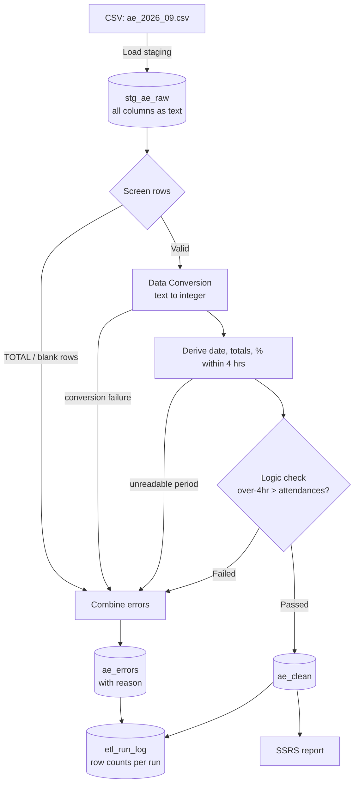

# NHS A&E 4-Hour Performance: SSIS ETL Pipeline and SSRS Report

An end-to-end SQL Server pipeline that loads NHS England's monthly A&E attendances data, validates and cleans it with SSIS, reconciles every row, and reports 4-hour performance by region with SSRS.

**Stack:** SQL Server 2022 · SSIS (Visual Studio 2022) · SSRS (Report Server Project) · T-SQL

**Data:** [NHS England A&E Attendances and Emergency Admissions](https://www.england.nhs.uk/statistics/statistical-work-areas/ae-waiting-times-and-activity/), provider-level CSV, September 2026. This is public, aggregate data with no patient-level information.

---

## Pipeline



**Control flow:** Truncate tables → Load staging → Validate and load clean → Write run log


---

## Data quality and reconciliation

Every row is accounted for. Row counts are captured at each stage and written to `etl_run_log` under a unique RunID for each execution.

| Step | Rows |
|---|---|
| Rows read from CSV | 192 |
| Rows loaded to `ae_clean` | 191 |
| Rows rejected to `ae_errors` | 1 |

**192 = 191 + 1.** The single rejected row is the national `TOTAL` summary row. It is excluded on purpose so that it isn't double-counted, and it is logged with the reason *"Summary TOTAL row excluded"*.


---

## Design decisions

- **Text staging.** Every CSV column is loaded into staging as `NVARCHAR`, so malformed values never stop the load. Type conversion happens afterwards, where failures can be redirected and logged instead of failing the package.
- **Nothing silently dropped.** Excluded rows, conversion failures, derivation failures and logic-check failures all route through a Union All into `ae_errors`, each with a reason.
- **Period parsing.** `MSitAE-SEPTEMBER-2026` is converted to a proper date (`2026-09-01`) in a Derived Column expression, and any unreadable month is redirected to the error path.
- **4-hour measure across all types.** Many sites, such as walk-in centres, record zero Type 1 attendances, so a Type 1-only percentage would divide by zero. The measure uses all A&E types including booked appointments: `(total attendances − total over 4 hrs) / total attendances`. It returns NULL where there are no attendances.
- **Logic check.** A row is rejected if over-4-hour waits exceed attendances, which is impossible in valid data.
- **Re-runnable.** Target tables are truncated at the start of each run, so the package can be run repeatedly with consistent results. The run log keeps its history.

---

## Report

An SSRS report with a multi-select **Region** parameter, a matrix of attendances and % seen within 4 hours, and a bar chart sorted by performance.

| Region | Attendances | % within 4 hrs |
|---|---:|---:|
| London | 432,712 | 77.0% |
| South East | 376,448 | 76.2% |
| North East and Yorkshire | 379,212 | 75.2% |
| East of England | 249,177 | 74.0% |
| Midlands | 448,136 | 72.9% |
| North West | 340,301 | 71.8% |
| South West | 218,757 | 71.8% |

*September 2026. All seven regions were below the 95% constitutional standard.*


Full export: [docs/AE_4hr_report.pdf](docs/AE_4hr_report.pdf)

---

## Repository structure

```
sql/
  02_rebuild_tables.sql      staging, clean, error and run-log tables
  03_alter_runlog.sql        RunID stored as text (SSIS passes the GUID as a string)
  04_check_run_log.sql       reconciliation query for the latest run
AE_ETL/Package.dtsx          SSIS package
AE_Reports/AE_4hr_Performance.rdl   SSRS report
docs/                        screenshots and PDF export
```

## How to run

1. Create a database `NHS_AE` in SQL Server 2022 and run the scripts in `sql/` in order.
2. Download a monthly provider-level A&E CSV from NHS England and save it as `C:\ssis-ae\data\ae_2026_09.csv`, or update the `FF_AE_CSV` connection manager to point at your file.
3. Open the package in Visual Studio 2022 with the *SQL Server Integration Services Projects* extension, check that `localhost.NHS_AE` points to your server, and run it (F5).
4. Check the reconciliation with `sql/04_check_run_log.sql`.
5. Open the report in a Report Server Project, point the shared data source at your server, and preview it.

## Possible extensions

- A Foreach Loop container to load several months of files in one run
- Lookup against an organisation reference table to validate `OrgCode`
- Deployment to the SSIS catalogue and SSRS report server, with a scheduled SQL Agent job
